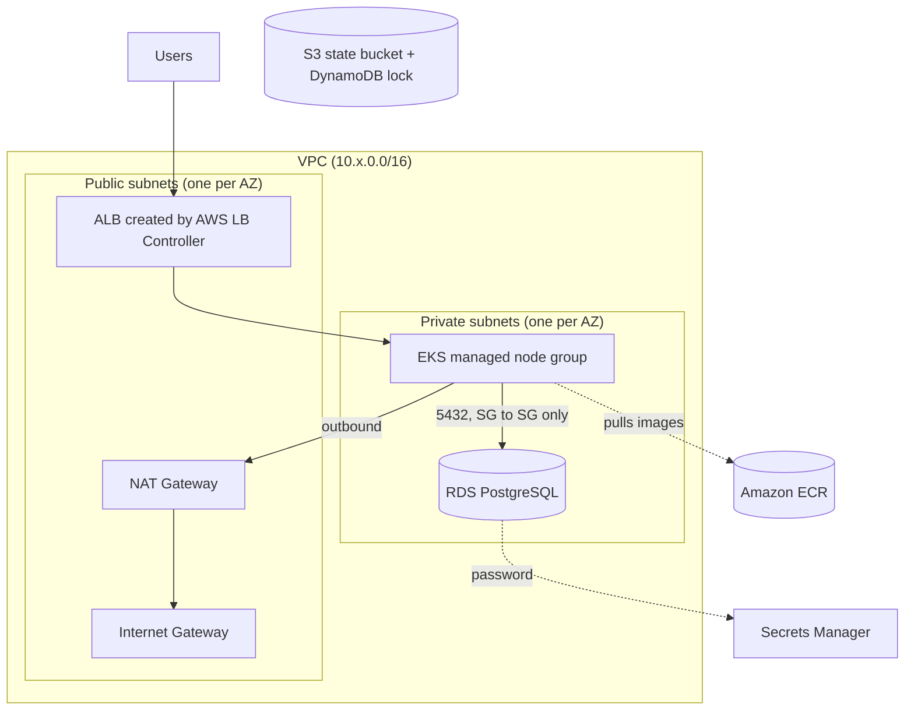

# Multi-Environment AWS Infrastructure with Terraform and Ansible

Infrastructure as Code for a production-style AWS setup: networking, an Amazon EKS cluster,
a PostgreSQL database and container registries. The same reusable modules build both **dev** and
**prod**, with different sizes and safety settings for each.


## Architecture



## Repository layout

```
bootstrap/          one-time S3 bucket + DynamoDB table for remote state
modules/
  vpc/              VPC, public/private subnets, IGW, NAT, route tables, flow logs
  eks/              EKS cluster, KMS secrets encryption, node group, add-ons, IRSA OIDC provider
  rds/              PostgreSQL in private subnets, password managed in Secrets Manager
envs/
  dev/              values set as variable defaults; small and cheap: 2 AZs, 1 NAT gateway, SPOT nodes, single-AZ DB
  prod/             3 AZs, NAT per AZ, on-demand nodes, Multi-AZ DB, deletion protection
ansible/            baseline hardening and node_exporter for EC2 hosts (dynamic inventory)
.github/workflows/  fmt, validate and config scan on every PR; plan and apply via OIDC
```

## Dev vs prod

| Setting | dev | prod |
|---|---|---|
| Availability zones | 2 | 3 |
| NAT gateways | 1 (shared) | 1 per AZ |
| Node capacity | SPOT t3.medium / t3a.medium | On-demand m6i.large |
| Node group size | 1 to 3 | 3 to 9 |
| EKS API access | open | office VPN IP only |
| RDS | db.t4g.micro, single AZ | db.t4g.medium, Multi-AZ |
| DB backups | 3 days | 14 days, deletion protection on |

## Security decisions

- Worker nodes and the database sit in private subnets. Only the load balancer is public.
- Kubernetes secrets are encrypted with a customer-managed KMS key with rotation enabled.
- The RDS master password is never in code or state. RDS generates it and stores it in Secrets Manager.
- The database security group only accepts traffic from the EKS cluster security group.
- Remote state is versioned, encrypted and locked with DynamoDB to stop two people applying at once.
- CI logs in to AWS with GitHub OIDC, so there are no long-lived access keys in GitHub.
- ECR repositories use immutable tags and scan on push. A lifecycle rule keeps the last 30 images.

## How to use

```bash
# 1. One time: create the state bucket and lock table
cd bootstrap && terraform init && terraform apply

# 2. Build an environment
cd ../envs/dev
terraform init
terraform plan -out=tfplan
terraform apply tfplan

# 3. Connect to the cluster
$(terraform output -raw kubeconfig_command)
kubectl get nodes

# 4. Configure EC2 hosts with Ansible
cd ../../ansible
ansible-galaxy collection install -r requirements.yml
ansible-playbook site.yml -l env_dev
```

## CI/CD

The GitHub Actions workflow runs `terraform fmt`, `terraform validate` and a Trivy config scan on every
pull request. Plan (on PRs) and apply (on merge to `main`) only run once the repository variable
`AWS_ENABLED` is set to `true` and the `AWS_TERRAFORM_ROLE_ARN` secret exists. The `prod` GitHub
environment has required reviewers, so prod changes wait for a manual approval.

## Related

The EKS cluster built here runs the services from
[cicd-eks-microservices](https://github.com/sid9743/cicd-eks-microservices) and
[mlops-churn-k8s](https://github.com/sid9743/mlops-churn-k8s).

## Tech stack

Terraform, AWS (VPC, EKS, EC2, RDS, IAM, KMS, S3, DynamoDB, ECR, CloudWatch, Secrets Manager),
Ansible, GitHub Actions, Trivy
